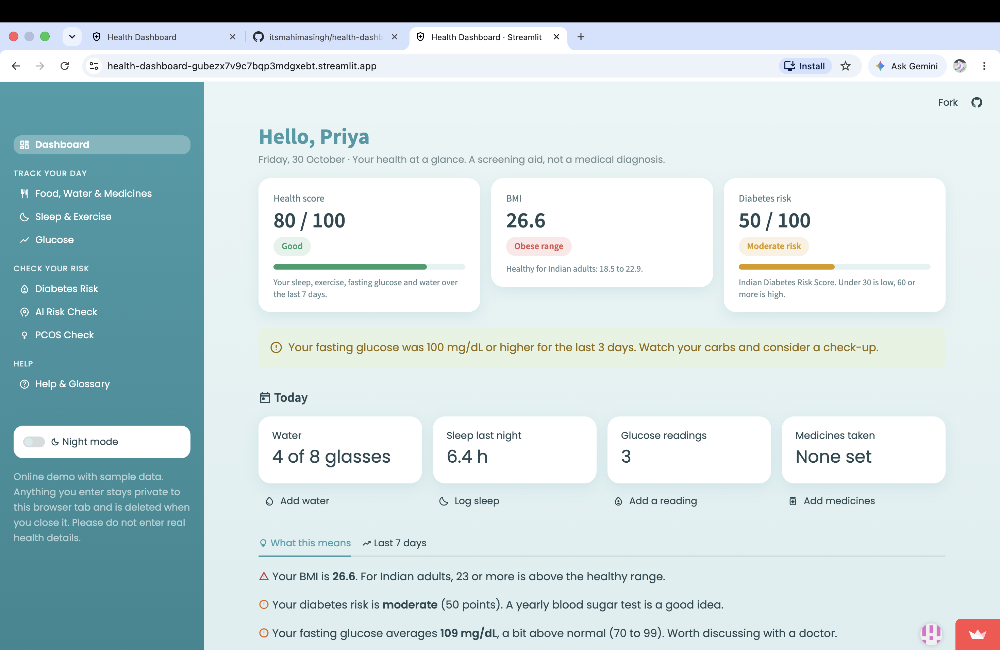
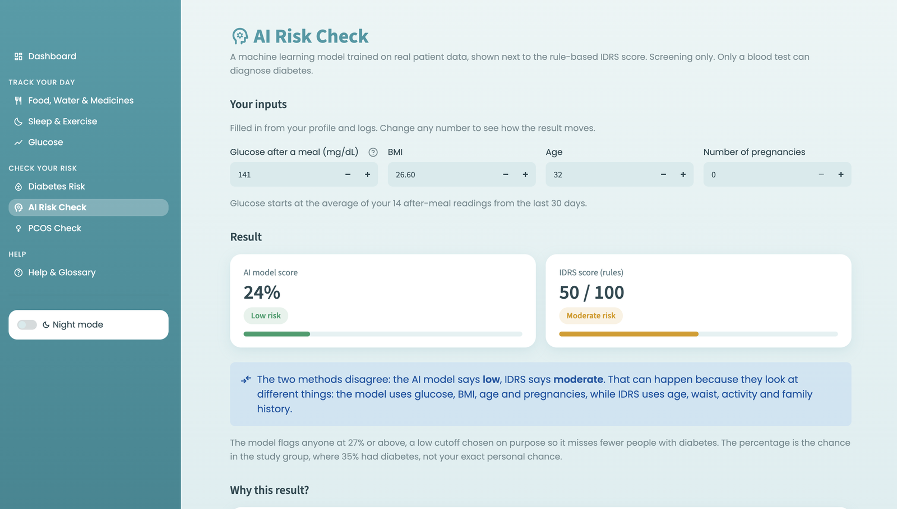
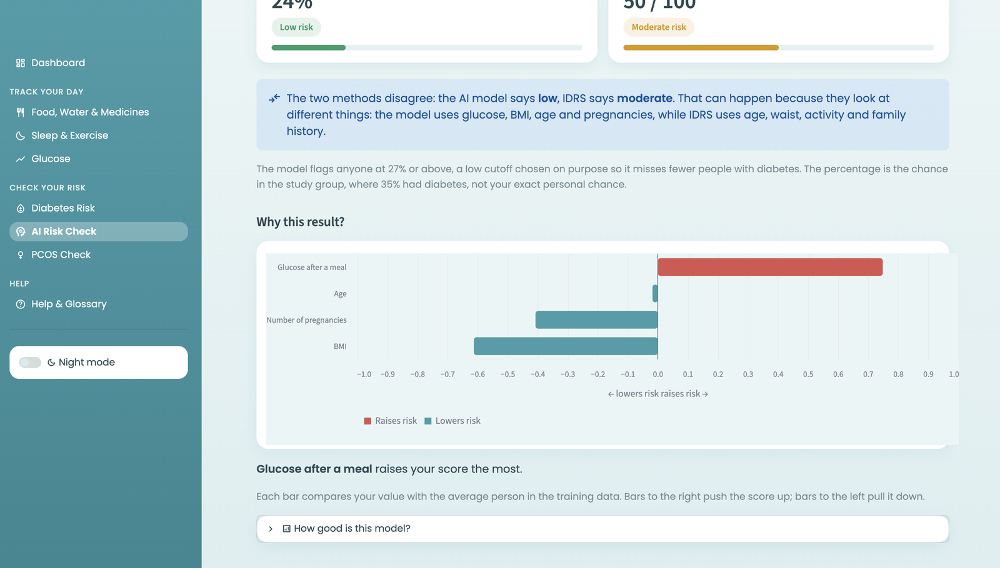
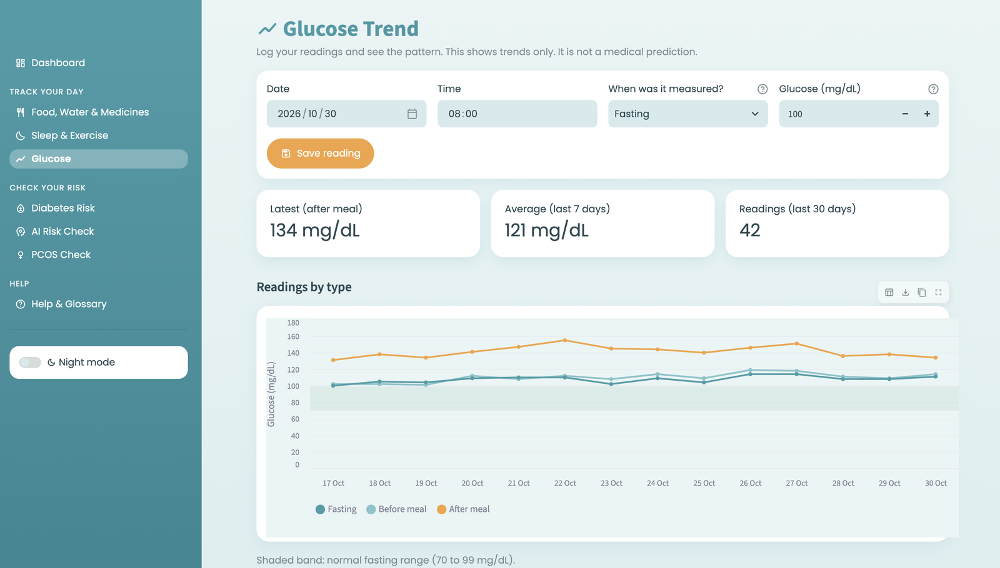
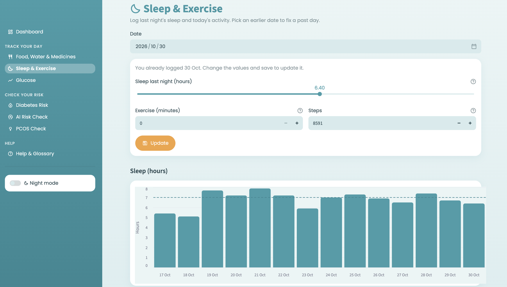

# Personal Health Dashboard

**Live demo:** [Open the app](https://health-dashboard-gubezx7v9c7bqp3mdgxebt.streamlit.app)

A health tracking and diabetes screening website built with Python and Streamlit, made for Indian users
(Indian foods, chai, and the Indian Diabetes Risk Score).

> Screening and tracking aid only, not a medical diagnosis. The demo uses fake data.

## Screenshots



| AI Risk Check | Why this result? |
|---|---|
|  |  |
| **Glucose** | **Sleep & Exercise** |
|  |  |

## Features

**Dashboard**: your health score, BMI and diabetes risk, each explained in one line; alerts when glucose or sleep stays off
for 3 days; a "Today" checklist with links to log what is missing; and a plain-language summary.

**Track your day**
- **Food, Water & Medicines**: meals from a list of common Indian foods, water, tea and chai, and a medicine checklist
- **Sleep & Exercise**: daily log with charts against goals
- **Glucose**: readings by type, a 7-day trend outlook, and automatic spike detection

**Check your risk**
- **Diabetes Risk**: Indian Diabetes Risk Score (IDRS) with a personal lifestyle plan
- **AI Risk Check**: a machine learning model that estimates diabetes risk, explains which inputs drove the result, and compares itself with IDRS
- **PCOS Check**: screening questions based on the Rotterdam criteria (shown for female profiles)

**Help & Glossary**: how to start, normal ranges for glucose, BMI and HbA1c, simple definitions, and safety notes.

Also: night mode, hints on every confusing field, and a private demo mode for the online version.

## The AI model

| | |
|---|---|
| Data | Pima Indians Diabetes Database (NIDDK), 768 women |
| Inputs | Glucose, BMI, age, pregnancies |
| Model | Logistic regression (as accurate as random forest and gradient boosting in cross-validation, and explainable) |
| Cutoff | Chosen to catch about 80% of diabetes cases, since a missed case is worse than a false alarm |
| Test results (154 unseen people) | Recall 80%, precision 57%, accuracy 72%, ROC AUC 0.80 |

The training, model comparison and limitations are in [`notebooks/train_diabetes_model.ipynb`](notebooks/train_diabetes_model.ipynb).
The trained model is saved as plain numbers in `models/diabetes_model.json`, so the app runs without scikit-learn.

**Limitations:** the data covers only women of Pima heritage, so the model is shown only for female profiles and may not fit
Indian adults well. The app keeps IDRS next to it for that reason.

## Tech stack

Python, Streamlit, pandas, Altair, SQLite, scikit-learn (training only), pytest, GitHub Actions

## Project structure

```
app.py            menu, grouped into sections
views/            one file per page
database.py       all SQLite reads and writes
scoring.py        IDRS, BMI and PCOS rules
analysis.py       glucose spike detection and trend line
model.py          runs the trained AI model
ui.py             shared cards, colours and charts
tests/            automated tests (pytest)
notebooks/        model training
models/           trained model (JSON)
data/             food values and the diabetes dataset
```

## Run it

```
pip3 install -r requirements.txt
python3 -m streamlit run app.py
```

Click "Load demo data" on the Dashboard to see everything filled in.

To retrain the model, install `requirements-dev.txt` and run the notebook from the `notebooks` folder.

## Tests

66 automated tests check the scoring rules, glucose spike detection, the AI model and the database.
They run on GitHub automatically every time the code changes (see the Actions tab).

```
pip3 install pytest
python3 -m pytest
```

## Credits

Diabetes data: Pima Indians Diabetes Database, National Institute of Diabetes and Digestive and Kidney Diseases.
IDRS: Mohan V. et al., Madras Diabetes Research Foundation.
